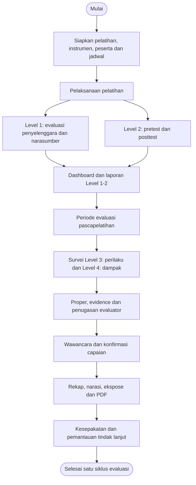
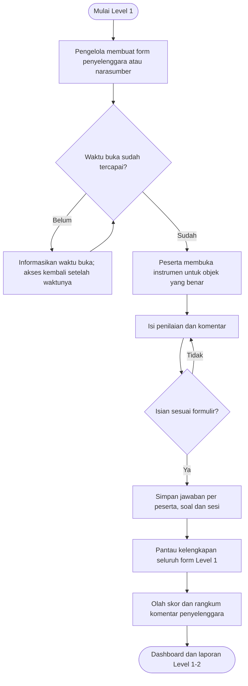
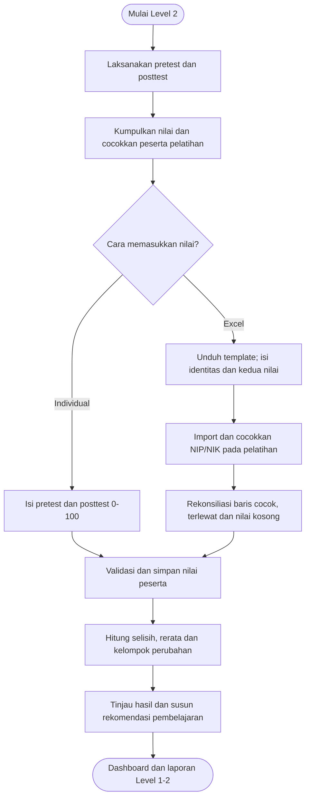
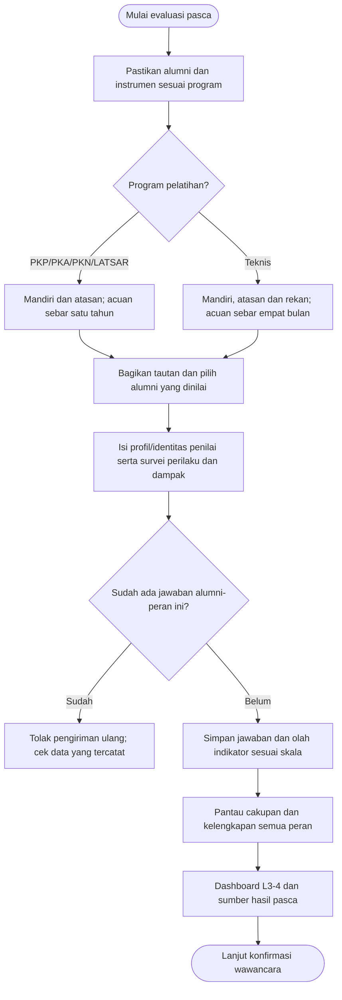
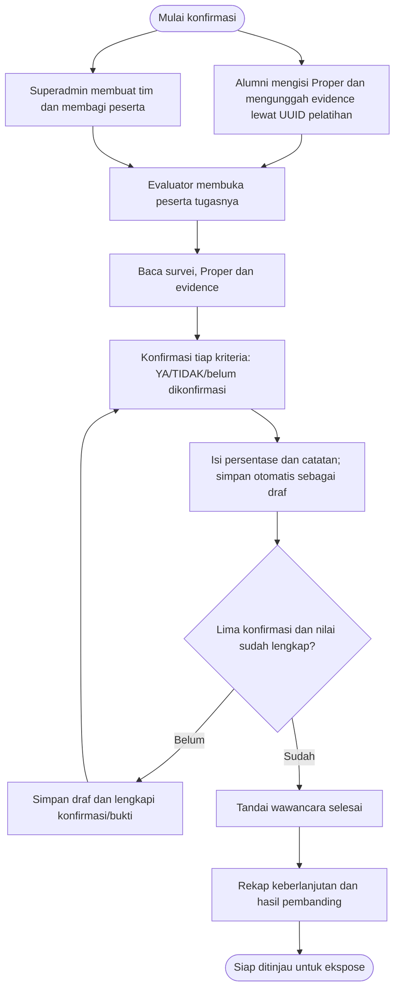
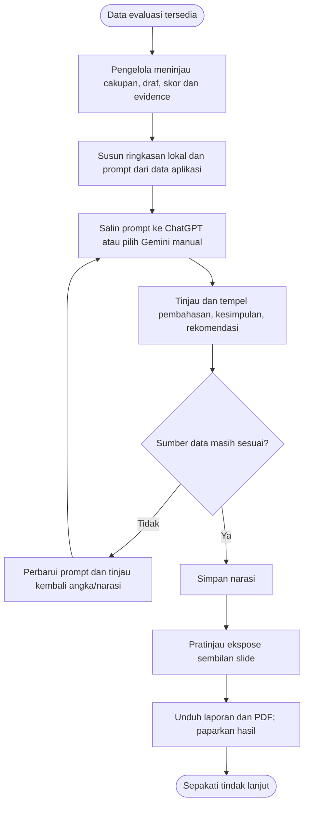

# Proses Bisnis Evaluasi Pelatihan Level 1, 2, 3, dan 4

**Aplikasi:** Integral - BPSDM Provinsi Jawa Barat  
**Versi:** 19 November 2026  
**Cakupan:** persiapan instrumen, pengumpulan data, pengolahan, survei pascapelatihan, konfirmasi wawancara, penyusunan narasi, ekspose, dan tindak lanjut.

Dokumen ini disusun dari alur aplikasi di F:/integral, termasuk penyesuaian terbaru dari F:/pasca. Nama pelatihan, peserta, program, serta pertanyaan tetap menggunakan data pelatihan masing-masing. Ini adalah panduan operasional aplikasi, bukan penetapan kebijakan kelulusan atau pengganti SOP resmi instansi.

## 1. Gambaran dan tujuan tiap level

| Level | Fokus evaluasi | Pertanyaan utama | Sumber data | Waktu operasional | Hasil utama |
| --- | --- | --- | --- | --- | --- |
| Level 1 - Reaksi | Persepsi terhadap penyelenggaraan dan pengajar | Bagaimana pengalaman peserta selama pelatihan? | Kuesioner penyelenggara dan narasumber | Penyelenggara mulai hari terakhir; narasumber setelah sesi selesai | Skor, komentar, dan prioritas perbaikan layanan/pengajar |
| Level 2 - Pembelajaran | Perubahan hasil belajar | Apakah skor setelah pelatihan lebih baik? | Pasangan nilai pretest dan posttest | Pretest sebelum pembelajaran; posttest setelah pembelajaran | Selisih nilai dan kelompok meningkat/tetap/menurun |
| Level 3 - Perilaku | Penerapan kompetensi dalam pekerjaan | Apakah perilaku kerja berubah dan kompetensi diterapkan? | Penilaian alumni, atasan, serta rekan pada program Teknis | Setelah alumni kembali bekerja; mengikuti jadwal evaluasi pasca | Indeks perubahan perilaku, dukungan, hambatan, dan kebutuhan konfirmasi |
| Level 4 - Hasil/dampak | Capaian dan manfaat bagi organisasi/penerima layanan | Apa hasil nyata penerapan kompetensi atau aksi perubahan? | Survei dampak, Proper, evidence, dan wawancara evaluator | Periode evaluasi pasca dan ekspose | Capaian, keberlanjutan, manfaat, rekomendasi, dan paparan hasil |

Level 3 dan Level 4 dikumpulkan dalam satu rangkaian survei dampak. Wawancara/ekspose memperkuat konfirmasi capaian, bukan menggantikan jawaban survei. Skor tinggi tidak otomatis membuktikan seluruh dampak disebabkan oleh pelatihan.

## 2. Aktor dan tanggung jawab

| Aktor | Tanggung jawab dalam proses | Batas peran |
| --- | --- | --- |
| Superadmin | Mengelola bank instrumen; mengawasi seluruh pelatihan; mengelola modul hasil pasca, tim evaluator, impor historis, narasi dan ekspose | Meninjau kelengkapan dan kewajaran sebelum hasil dipakai dalam laporan |
| Admin Bidang/pengelola pelatihan | Menyiapkan data pelatihan, jadwal dan peserta; membuat formulir L1; memasukkan L2; memantau survei dan dashboard sesuai kewenangan | Modul Hasil Evaluasi Pasca/ekspose dikelola Superadmin, bukan Admin Bidang |
| Peserta/alumni | Melengkapi profil dan dokumen, mengisi L1 dan survei mandiri L3-4, mengirim Proper beserta evidence | Akun peserta mengisi atas nama dirinya sendiri |
| Atasan langsung | Menilai penerapan kompetensi dan dampak alumni yang diamati | Menggunakan instrumen atasan untuk pelatihan dan alumni yang tepat |
| Rekan kerja | Memberi penilaian pengamatan kerja pada program Teknis | Tidak menjadi sumber penilai pada PKP, PKA, PKN, dan LATSAR |
| Narasumber/pengajar | Menjadi objek evaluasi L1 per sesi; menyediakan hasil asesmen sebagai bahan L2 sesuai tata kerja penyelenggara | Input nilai L2 dilakukan pengelola; bukan otomatis diambil dari LMS |
| Evaluator/tim | Membaca Proper dan survei, mengonfirmasi capaian, mengisi YA/TIDAK, persentase dan catatan wawancara | Hanya pelatihan dan peserta yang ditugaskan; tidak mengelola AI, ekspose, PDF, atau link publik |
| Pimpinan/penyelenggara/unit kerja | Meninjau hasil, menyepakati tindak lanjut, dan memantau pelaksanaannya | Rekomendasi belum dianggap terlaksana hanya karena sudah ditulis |

Peran administratif ditetapkan admin. Akun yang mendaftar melalui pelengkapan profil menjadi peserta; satu akun dapat memiliki beberapa peran, dengan akses mengikuti peran aktif.

## 3. Persiapan bersama sebelum evaluasi

1. Pengelola menetapkan identitas pelatihan: nama, angkatan, bidang, program evaluasi, metode, lokasi, periode, dan jumlah peserta.
2. Superadmin memastikan bank soal sesuai program. LATSAR, PKP, PKA, PKN mempunyai instrumen masing-masing; Teknis memakai instrumen Teknis.
3. Pengelola melengkapi jadwal, sesi dan pengajar; sesi menjadi dasar objek evaluasi narasumber.
4. Peserta didaftarkan atau diimpor ke pelatihan, diverifikasi, lalu disetujui. Profil pendaftaran peserta meminta NIP 18 digit dan NIK 16 digit secara terpisah.
5. Pengelola memeriksa dokumen peserta dan hubungan peserta-pelatihan. Identitas pada berkas Excel harus sama dengan identitas peserta yang sudah terdaftar.
6. Tetapkan penanggung jawab pemantauan respons, penyedia nilai, tim konfirmasi, dan pihak peninjau laporan.

**Keluaran persiapan:** pelatihan dan peserta siap, bank instrumen sesuai, jadwal/pengajar tersedia, serta pembagian tanggung jawab jelas.

### Flowchart 1 - Alur evaluasi menyeluruh

## 4. Proses bisnis Level 1 - Reaksi

### 4.1 Masukan dan pemicu

Masukannya adalah instrumen L1 yang berlaku, data peserta, periode pelatihan, dan jadwal pengajar. Pemicu pengisian bukan hanya formulir sudah dibuat: waktu bukanya harus tercapai.

| Objek | Disiapkan pengelola | Waktu buka otomatis dalam aplikasi |
| --- | --- | --- |
| Penyelenggara | Form bernama dan identitas instansi penyelenggara | Awal hari pada tanggal selesai pelatihan, zona Asia/Jakarta |
| Narasumber | Form ditautkan ke sesi yang mempunyai pengajar; nama pengajar dan materi mengikuti jadwal | Tanggal dan jam akhir sesi yang dievaluasi |

### 4.2 Langkah kerja

1. Pengelola membuka Evaluasi L1 pelatihan dan membuat form penyelenggara atau narasumber.
2. Sistem menautkan form ke pelatihan; untuk narasumber, sistem memeriksa sesi dan pengajar pada pelatihan yang sama.
3. Pengelola membagikan tautan form atau peserta membukanya dari ruang pelatihannya.
4. Sistem memeriksa keberadaan form dan waktu buka. Jika belum waktunya, pengisian ditolak dengan informasi waktu buka.
5. Peserta memilih identitas yang benar. Pada akun peserta, sistem mengikat pengisian ke peserta disetujui milik akun tersebut.
6. Peserta menilai indikator dan memberi komentar sesuai jenis soal. Slider L1 pada form publik saat ini tersedia dari 10 sampai 100; isian teks dan pilihan mengikuti bank soal.
7. Peserta memeriksa kembali dan mengirim jawaban. Jawaban disimpan per pelatihan, peserta, soal, dan sesi/objek.
8. Pengelola memantau progres per objek: peserta yang sudah mengisi satu pengajar belum tentu sudah mengisi penyelenggara atau seluruh pengajar lainnya.
9. Pengelola menelaah indikator rendah serta komentar penyelenggara, kemudian menyimpan kesimpulan dan rekomendasi; bantuan AI bersifat pilihan yang harus ditinjau.
10. Hasil dibaca melalui dashboard L1-2 dan dimasukkan dalam laporan evaluasi.

**Keluaran:** jawaban L1, progres per form, rerata penyelenggara/pengajar, komentar dan rangkuman evaluasi penyelenggara.

### Flowchart 2 - Level 1

## 5. Proses bisnis Level 2 - Pembelajaran

### 5.1 Masukan dan pelaksana

Masukannya adalah nilai pretest dan posttest dari asesmen yang dilaksanakan penyelenggara. Integral saat ini menyimpan dan mengolah pasangan nilai; modul ini bukan mesin ujian online dan belum otomatis menarik nilai dari LMS.

### 5.2 Langkah kerja

1. Penyelenggara melaksanakan pretest sebelum proses pembelajaran dan posttest setelahnya.
2. Pengelola mengumpulkan nilai dan mencocokkannya dengan peserta pada pelatihan.
3. Pilih input individual atau unduh template Excel pelatihan yang sudah berisi daftar peserta.
4. Untuk input individual, masukkan pretest dan posttest. Sistem memvalidasi keduanya sebagai angka 0-100 lalu membuat/memperbarui nilai peserta.
5. Untuk Excel, pertahankan NIP/NIK sebagai teks dan isi kedua kolom nilai. Nama membantu pemeriksaan, sedangkan pencocokan dilakukan dengan identitas pada pelatihan yang dipilih.
6. Impor nilai; sistem memperbarui peserta yang cocok. NIP/NIK yang tidak ditemukan dilewati, sehingga pengelola perlu merekonsiliasi hasil setelah impor.
7. Periksa kembali pasangan nilai; jangan biarkan sel kosong jika nilai belum diketahui. Importer L2 saat ini dapat mengisi sel kosong sebagai 0, berbeda dari data tidak tersedia.
8. Dashboard menghitung rerata pretest, rerata posttest, perubahan poin, dan jumlah peserta meningkat/tetap/menurun.
9. Pengelola menelaah penurunan atau tidak adanya peningkatan, menghubungkannya dengan konteks asesmen, lalu menyusun rekomendasi pembelajaran.

**Rumus:** selisih peserta = posttest - pretest. Contoh 60 menjadi 80 berarti naik 20 poin. Ini bukan normalized gain atau kenaikan 20 persen. Rerata selisih dibaca bersama jumlah peserta yang mempunyai rekaman nilai.

**Keluaran:** pasangan nilai L2, perubahan hasil belajar, ringkasan kelompok dan laporan gabungan L1-2.

### Flowchart 3 - Level 2

## 6. Proses bisnis Level 3 dan 4 - Survei pascapelatihan

### 6.1 Program, sumber penilai dan jadwal

| Program | Penilai survei | Tanggal sebar yang dihitung aplikasi |
| --- | --- | --- |
| PKP, PKA, PKN, LATSAR | Mandiri/alumni dan atasan langsung | Satu tahun setelah tanggal selesai pelatihan |
| Teknis, termasuk sebutan lama PKTI/PKTU | Mandiri/alumni, atasan langsung dan rekan kerja | Empat bulan setelah tanggal selesai pelatihan |

Jadwal tersebut menjadi acuan pemantauan serta penanda evaluasi pasca tersedia pada portal peserta. Pada controller publik L3-4 saat ini, tanggal tersebut belum menjadi pengunci server untuk setiap akses langsung. Pengelola tetap mengatur waktu distribusi tautan sesuai periode evaluasi.

### 6.2 Langkah pengumpulan

1. Pengelola meninjau sasaran alumni dan bank soal tiap sumber penilai.
2. Saat periode evaluasi tiba, pengelola membagikan gateway/tautan mandiri dan atasan; rekan ditambahkan khusus Teknis.
3. Sistem menampilkan peran dan instrumen yang berlaku. Peran yang tidak sesuai program atau belum mempunyai instrumen tidak dapat dibuka sebagai form yang sah.
4. Alumni memilih identitas dan mengisi profil saat pelatihan dibanding kondisi terkini: pendidikan, pangkat, jabatan, unit dan instansi.
5. Atasan/rekan mengisi identitas penilai dan memilih alumni yang dinilai, lalu menjawab berdasarkan pengamatan.
6. Responden menjawab bagian perilaku, dampak, serta faktor pendukung/penghambat atau bagian lain yang berlaku pada programnya.
7. Sistem menyimpan jawaban menurut pelatihan, alumni, penilai dan pertanyaan. Pengiriman ulang untuk alumni-peran yang sama ditolak dalam alur publik L3-4.
8. Dashboard memisahkan penilai yang belum mulai, mulai mengisi dan lengkap pada seluruh pertanyaan skala aktif. Satu jawaban profil tidak berarti survei sudah lengkap.
9. Pengelola menindaklanjuti kekurangan respons dan memastikan interpretasi dukungan/hambatan tidak tertukar.

**Keluaran:** profil alumni terkini, hasil survei per peran, progres, indeks perilaku L3, indeks dampak L4 dan rincian indikator.

### 6.3 Aturan skala

| Jawaban pada instrumen empat tingkat | Nilai asli | Konversi 100 |
| --- | --- | --- |
| Tidak Sesuai | 1 | 25 |
| Kurang Sesuai | 2 | 50 |
| Sesuai | 3 | 75 |
| Sangat Sesuai | 4 | 100 |

Konversi empat tingkat berlaku pada program PKP, PKA, PKN dan LATSAR ketika instrumennya menggunakan pilihan tersebut. Slider menggunakan angka aslinya 0-100, termasuk nol. Teks, profil, dan dropdown YA/TIDAK bukan otomatis angka indeks. Semakin tinggi persetujuan terhadap pernyataan hambatan berarti hambatan lebih kuat, bukan hasil pelatihan lebih baik.

### Flowchart 4 - Survei Level 3 dan 4

## 7. Hubungan dashboard survei dan modul hasil pasca

Ada dua ruang kerja yang berbeda, tetapi sumber peserta dan surveinya tetap database Integral.

| Ruang kerja | Fungsi | Pengguna utama |
| --- | --- | --- |
| Dashboard Evaluasi L3-4 | Memantau instrumen lengkap, respons per peran, perilaku, dampak, dan kebutuhan tindak lanjut | Superadmin dan Admin Bidang yang sesuai |
| Hasil Evaluasi Pasca L3-4 | Menggabungkan jawaban, Proper, penugasan, wawancara, rekap keberlanjutan, narasi dan ekspose | Superadmin dan evaluator sesuai penugasan |

Untuk ekspose, tiga indikator pembanding diambil otomatis dari survei mandiri, bukan mencampur nilai mandiri dan atasan. Pada PKP/PKA: target aksi perubahan jangka panjang, tujuan aksi perubahan, dan manfaat aksi perubahan. PKN menggunakan padanan proyek perubahan; LATSAR menggunakan keberlanjutan, capaian dan realisasi aktualisasi. Instrumen Teknis dipakai bila tersedia soal slider yang sesuai sumber otomatis; jangan mengarang nilai ketika soal padanannya tidak tersedia.

Grafik ringkasan perbandingan alumni dan atasan tetap memisahkan sumber penilai. Tiga indikator pembanding bukan seluruh isi bank soal dan bukan pengganti indeks dashboard penuh.

## 8. Proses Proper, penugasan dan wawancara

### 8.1 Proper dan evidence dari alumni

1. Superadmin membagikan satu tautan pengisian Proper per pelatihan berbasis UUID.
2. Alumni memasukkan identitas peserta yang telah terdaftar/disetujui pada pelatihan tersebut.
3. Alumni mengisi judul inovasi/Proper, kondisi saat ini, milestone jangka menengah dan panjang, serta status evidence.
4. Alumni mengunggah dokumen Proper dan evidence yang diminta.
5. Data dan dokumen terhubung ke pelatihan serta peserta, dan dapat dibaca evaluator di halaman wawancara. Upload dipusatkan pada form publik; tidak membuat link atau upload ulang per peserta dari form wawancara.

### 8.2 Tim dan penugasan

1. Superadmin membuat nama tim.
2. Tambahkan evaluator dari user yang sudah ada atau daftarkan user evaluator baru dengan nama, email dan password.
3. Sistem dapat membagi peserta disetujui secara otomatis dan merata; peserta yang sudah mempunyai pembagian dipertahankan.
4. Superadmin dapat mengganti anggota evaluator, memindahkan peserta ke tim lain, atau melepas penugasan.
5. Evaluator hanya melihat pelatihan yang ditugaskan; daftar dan ringkasan tim hanya memuat peserta tugasnya.

### 8.3 Konfirmasi dan penilaian

| Kriteria wawancara | Bobot awal |
| --- | --- |
| Target jangka menengah | 20% |
| Target jangka panjang | 20% |
| Ketercapaian tujuan | 20% |
| Manfaat hasil pelatihan | 30% |
| Teknik komunikasi | 10% |

1. Evaluator membuka peserta tugasnya dan membaca Proper, evidence serta jawaban survei.
2. Pada setiap kriteria pilih YA, TIDAK, atau belum dikonfirmasi.
3. YA: isi persentase 0-100 serta alasan/evidence. TIDAK: dicatat 0%, kecuali nilai lama 0-25% yang masih tersimpan dan dipertahankan. Belum dikonfirmasi: nilai dikosongkan.
4. Isi catatan hasil wawancara untuk menjelaskan capaian, kendala, bukti dan alasan pemberian nilai. Pilihan YA tidak otomatis menetapkan nilai 100.
5. Sistem menyimpan otomatis setelah jeda perubahan; tombol Simpan tetap tersedia. Nilai maksimum 100, minimum 0.
6. Selama belum lengkap, simpan sebagai draf. Untuk status selesai, kelima konfirmasi dan kelima nilai harus terisi.
7. Jika revisi berubah akibat perangkat lain, penyimpanan ditolak agar tidak menimpa data terbaru. Salin catatan, muat ulang, dan lakukan rekonsiliasi.
8. Rekap menampilkan YA/TIDAK/belum dikonfirmasi, jumlah draf, serta rerata hanya dari jawaban YA yang mempunyai persentase.

### Flowchart 5 - Proper dan wawancara

## 9. Pengolahan nilai dan kategori

| Ukuran | Perhitungan | Cara membaca |
| --- | --- | --- |
| Rerata L1 | Jumlah skor numerik / jumlah jawaban numerik | Dipisahkan antara penyelenggara dan narasumber; komentar tidak menjadi angka |
| Selisih L2 | Posttest - pretest | Poin perubahan; positif meningkat, nol tetap, negatif menurun |
| Indeks dashboard L3/L4 | Rerata indikator terisi pada bagian perilaku/dampak | Peran dipisahkan; jumlah jawaban valid harus dibaca bersama indeks |
| Survei pembanding ekspose | Rerata tiga indikator mandiri yang terisi | Tidak mencampurkan nilai penilai lain |
| Wawancara ekspose | Rerata kriteria jangka panjang, tujuan dan manfaat yang terisi | Rerata parsial boleh tersedia, tetapi harus disebutkan keterbatasannya |
| Nilai akhir berbobot | 0,20 x menengah + 0,20 x panjang + 0,20 x tujuan + 0,30 x manfaat + 0,10 x komunikasi | Hanya tersedia bila kelima nilai terisi; bobot mengikuti konfigurasi tersimpan |
| Rerata jawaban YA | Jumlah persentase terisi pada jawaban YA / jumlah jawaban YA yang mempunyai nilai | Tidak memasukkan TIDAK atau YA yang belum diisi nilainya |

Contoh wawancara: [80, 90, 70, 60, 100] menghasilkan nilai akhir berbobot 76,00, sedangkan wawancara ekspose adalah (90 + 70 + 60)/3 = 73,33. Dua hasil itu berbeda karena rumusnya memang berbeda.

**Kategori belum seragam pada semua modul aplikasi saat ini.** Jangan menggunakan satu kategori untuk menafsirkan semua halaman.

| Modul | Rentang kategori yang dipakai |
| --- | --- |
| Dashboard/laporan L1-2 | Sangat Kurang <=60; Kurang >60-70; Cukup >70-80; Baik >80-90; Sangat Baik >90 |
| Dashboard survei L3-4 | Kurang <=60; Cukup >60-79; Baik >79-89; Sangat Baik >89-100 |
| Wawancara dan grafik ekspose pasca terbaru | Kurang 0-25%; Cukup >25-50%; Baik >50-75%; Sangat Baik >75-100% |

Nilai kosong tidak otomatis nol dan tidak otomatis berarti peserta tidak hadir. Tampilkan jumlah terisi, belum terisi, draf dan lengkap. Kategori grafik bukan aturan kelulusan. Konversi nilai wawancara lama mengikuti migrasi Pasca dan memiliki salinan nilai asli; jangan melakukan konversi ulang manual.

## 10. Narasi, ekspose dan laporan

1. Superadmin memeriksa kecukupan data, respons penilai, evidence, status draf dan hasil wawancara.
2. Aplikasi menyediakan ringkasan dasar berbasis angka tanpa memanggil AI.
3. Buka Prompt ChatGPT & Edit Narasi. Prompt berisi agregat, rekap keberlanjutan dan catatan evaluator yang disamarkan; catatan tambahan dapat dilengkapi.
4. Salin prompt ke ChatGPT, tinjau hasil, lalu tempel pembahasan slide 4-8, kesimpulan dan rekomendasi slide 9.
5. Simpan dan Pratinjau menerapkan narasi pada ekspose dan PDF. Saat sumber data berubah, narasi ditandai untuk ditinjau dan formulir dengan sidik sumber lama tidak dapat disimpan begitu saja.
6. Generate Gemini tetap merupakan pilihan manual; membuka ringkasan, ekspose atau PDF tidak otomatis memanggil API AI.
7. Tinjau paparan sembilan slide. Mode layar penuh memakai ukuran tetap 16:9, satu slide per halaman; navigasi dengan tombol/panah, keluar dengan Esc.
8. Unduh PDF ekspose atau Excel survei sesuai kebutuhan. Laporan L1-2 dan L3-4 mempunyai keluaran Word masing-masing; pengaturan penandatangan tersedia pada laporan L3-4.
9. Hasil evaluasi, kehadiran, jadwal dan pengajar juga dapat menjadi sumber laporan kegiatan pelatihan. Ini tidak berarti setiap temuan otomatis berubah menjadi tugas tindak lanjut.

### Flowchart 6 - Narasi dan ekspose

## 11. Impor historis khusus survei Level 3-4

Impor ini pilihan untuk evaluasi yang sudah dilaksanakan di luar alur pengisian langsung, bukan prasyarat setiap pelatihan.

1. Impor/daftarkan peserta ke pelatihan dahulu dan selesaikan persetujuannya.
2. Superadmin membuka tab Import Data pada Hasil Evaluasi Pasca pelatihan.
3. Unggah workbook sesuai format yang didukung; sistem memeriksa peserta, program, pertanyaan dan pilihan jawaban.
4. Periksa pratinjau: cocok, belum cocok, soal ambigu, jawaban tidak sah, atau jawaban yang sudah ada.
5. Jika bermasalah, perbaiki sumber atau data referensi lalu periksa ulang; jangan memaksakan pencocokan nama yang meragukan.
6. Jika valid, konfirmasi pelatihan lalu simpan. Impor mengisi jawaban kosong; jawaban terisi dipertahankan.
7. Hasil langsung terbaca di Jawaban, Ringkasan dan Ekspose. Impor survei ini tidak mengimpor atau mengubah tim, akun, Proper, evidence, maupun nilai wawancara.

Pratinjau berlaku 24 jam dan hanya dapat dibuka pengunggah Superadmin untuk pelatihan yang sama. Jika sumber berubah sebelum konfirmasi, pemeriksaan ulang diperlukan. Riwayat impor disimpan untuk penelusuran.

## 12. Status, pengecualian dan titik kendali

| Kondisi | Tindakan operasional |
| --- | --- |
| Instrumen belum tersedia atau salah program | Superadmin melengkapi instrumen sebelum tautan dibagikan |
| Form L1 belum dibuka | Tunggu waktu buka; jangan mengubah jadwal hanya agar bisa mengisi |
| Peserta belum disetujui | Pengelola memverifikasi keikutsertaan lebih dahulu |
| NIP/NIK Excel tidak cocok | Periksa identitas dan pelatihan; jangan menggandakan peserta |
| Baru ada sebagian respons penilai | Tindak lanjuti penilai yang belum lengkap; laporan menyebutkan cakupan |
| Proper/evidence belum tersedia | Alumni melengkapi; evaluator menjelaskan keterbatasan, bukan mengarang bukti |
| Wawancara belum lengkap | Tetap draf; lengkapi konfirmasi dan nilai sebelum selesai |
| Benturan revisi | Salin catatan, muat ulang, lalu rekonsiliasi |
| Narasi sudah tidak sesuai data | Ambil prompt terbaru dan tinjau; jangan mengganti angka grafik lewat teks |
| Kegagalan AI | Gunakan ringkasan dasar atau alur salin prompt; data evaluasi tetap tersedia |
| Hasil sudah dipaparkan | Tetapkan penanggung jawab, target dan bukti tindak lanjut melalui tata kerja instansi |

Status daftar peserta seperti 'sudah mengisi' pada beberapa tampilan lama berdasarkan keberadaan jawaban. Dashboard L3-4 memberi pemeriksaan kelengkapan skala yang lebih rinci. Gunakan dashboard rinci untuk memutuskan kecukupan data, bukan satu badge saja.

Portal membedakan selesai proses inti pelatihan dari selesai seluruh kewajiban. Proses inti mengecek persetujuan, berakhirnya pelatihan, dokumen dan semua form L1; L2 tidak menjadi syarat pada pemeriksaan proses inti tersebut. Pemeriksaan seluruh kewajiban juga memeriksa keberadaan L2 serta survei mandiri L3-4. Jangan menyamakan kedua status ini dengan kelulusan akademik.

## 13. Tindak lanjut dan siklus perbaikan

1. Pisahkan temuan menurut level: layanan/pengajar (L1), pembelajaran (L2), penerapan dan hambatan kerja (L3), capaian/manfaat/keberlanjutan (L4).
2. Penyelenggara dan unit kerja membahas temuan dengan evaluator serta pemangku kepentingan yang relevan.
3. Susun daftar tindakan dengan kolom: temuan, sumber data, rencana tindakan, penanggung jawab, target waktu, indikator keberhasilan dan bukti penyelesaian.
4. Pantau pelaksanaan, minta bukti, dan catat status; rekomendasi narasi tidak otomatis berarti pekerjaan selesai.
5. Gunakan hasilnya untuk perbaikan kurikulum, metode, pengajar, dukungan tempat kerja, pendampingan alumni dan evaluasi periode berikutnya.

Contoh: skor narasumber rendah ditindaklanjuti dengan umpan balik dan perbaikan metode; selisih L2 negatif diperiksa bersama mutu asesmen; hambatan penerapan ditindaklanjuti dengan dukungan atasan; Proper yang belum berlanjut dikonfirmasi akar kendala serta rencana keberlanjutannya.

## 14. Peta halaman utama

Ganti {id} dengan ID pelatihan. Ganti {uuid} dengan UUID Proper pelatihan, bukan ID angka.

| Kebutuhan | Halaman |
| --- | --- |
| Kelola pelatihan | /trainings/{id}/manage |
| Kelola instrumen | /questions - Superadmin |
| Kelola form L1 | /trainings/{id}/evaluasi-l1 |
| Form publik L1 | /evaluasi-l1/form/{id}?type=penyelenggara atau type=narasumber&sid={sesi} |
| Nilai L2 | /trainings/{id}/evaluasi-l2 |
| Dashboard gabungan L1-2 | /trainings/{id}/evaluasi-l12/dashboard |
| Rangkuman penyelenggara | /trainings/{id}/evaluasi-l1/rangkuman-penyelenggara |
| Gateway survei L3-4 | /evaluasi-dampak/gateway/{id} |
| Form per penilai | /evaluasi-dampak/form/{id}/{mandiri,atasan,rekan} |
| Dashboard survei L3-4 | /trainings/{id}/evaluasi-l34/dashboard |
| Hasil pasca | /hasil-evaluasi-pasca/{id} |
| Pengisian Proper | /isi-proper/{uuid} |
| Wawancara | /hasil-evaluasi-pasca/{id}/wawancara/{peserta} |
| Prompt dan narasi | /hasil-evaluasi-pasca/{id}/ekspose/narasi |
| Ekspose | /hasil-evaluasi-pasca/{id}/ekspose |

Tautan survei publik L1/L3-4 saat ini masih memakai ID pelatihan; yang memakai UUID adalah tautan pengisian Proper. Jangan menganggap semua tautan publik telah diubah menjadi UUID. UI publikasi snapshot hasil agregat tidak ditampilkan; pengisian survei/Proper berbeda dari publikasi hasil.

## 15. Checklist penutupan evaluasi

- Program, instrumen, sasaran peserta dan penilai sudah tepat.
- Form L1 yang diperlukan tersedia; progres diperiksa per objek.
- Pasangan L2 sudah direkonsiliasi; tidak ada sel kosong yang disalahartikan nol.
- Cakupan dan kelengkapan L3-4 tiap peran sudah ditinjau.
- Proper dan evidence ditautkan pada peserta yang benar.
- Pembagian tim dan cakupan akses evaluator sudah sesuai.
- Wawancara yang selesai mempunyai kelima konfirmasi dan nilai.
- Rerata, kategori, nilai berbobot dan status parsial dijelaskan dengan benar.
- Narasi ditinjau terhadap data terkini; identitas tidak dimasukkan ke prompt eksternal tanpa keperluan.
- Ekspose, PDF dan laporan sudah diperiksa; tindak lanjut mempunyai penanggung jawab.

## 16. Sumber penyusunan dan batas dokumen

Sumber diperiksa pada kode lokal: EvaluationLevel1Controller, EvaluationFormL1, EvaluationLevel2Controller, ParticipantScoreImport, EvaluationLevel12ReportController, EvaluationLevel34Controller, EvaluationL34DashboardService, EvaluationProgram, Training, Participant, PostEvaluationService, PostEvaluationController, PostEvaluationImportService, PostEvaluationNarrativeService, serta routes/web.php.

Dokumen memisahkan tata kerja operasional dari pemeriksaan server yang sudah tersedia. Khususnya: jadwal sebar L3-4 belum merupakan pengunci semua URL langsung; beberapa rute publik lama belum membatasi sasaran sama ketatnya dengan alur peserta login; importer L2 belum memakai proses pratinjau/rekonsiliasi ketat seperti importer survei pasca. Karena itu persetujuan peserta, pemeriksaan sumber nilai, dan distribusi tautan tetap menjadi tanggung jawab pengelola.

Tidak ada perubahan kode aplikasi, nilai, jawaban atau database melalui penyusunan dokumen ini. Versi berikutnya perlu diperbarui jika SOP atau implementasi berubah.
