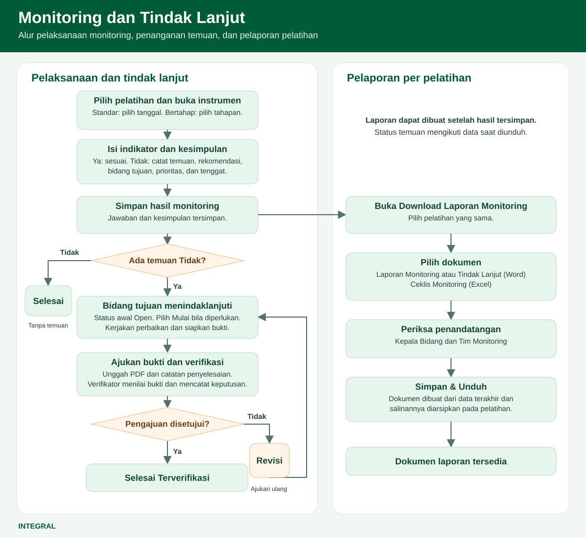

# Proses Bisnis Monitoring dan Tindak Lanjut

Proses dimulai saat petugas memonitor pelaksanaan pelatihan di Integral. Hasil pengisian menjadi dasar penanganan temuan, verifikasi tindakan perbaikan, dan penyusunan laporan per pelatihan.

## Pelaksana

| Pelaksana | Tanggung jawab |
| --- | --- |
| Admin Bidang penyelenggara | Mengisi instrumen untuk pelatihan bidangnya, mencatat temuan, menetapkan bidang tujuan, dan menyiapkan laporan. Dapat memverifikasi pengajuan apabila bidang tujuan berbeda dari bidang penyelenggara. |
| Admin Bidang tujuan | Mengerjakan temuan yang ditugaskan ke bidangnya, mengajukan catatan penyelesaian dan bukti, serta memperbaiki pengajuan yang dikembalikan. |
| Superadmin | Dapat mengelola monitoring dan laporan lintas bidang, mengerjakan tindak lanjut, serta memverifikasi pengajuan. Jika penyelenggara dan bidang tujuan sama, verifikasi dilakukan oleh Superadmin. |

## Proses bisnis

| Tahap | Kegiatan | Hasil |
| --- | --- | --- |
| Pelaksanaan monitoring | Buka **Monitoring & Tindak Lanjut → Instrumen Monitoring** dan pilih pelatihan. Untuk model standar, pilih tanggal dalam periode pelatihan. Untuk model bertahap, pilih tahapan. Isi indikator sesuai metode pelaksanaan. | Isian instrumen sesuai tanggal atau tahapan yang dipilih. |
| Pencatatan hasil | Jawab indikator **Ya** jika sesuai atau **Tidak** jika ada temuan. Untuk setiap jawaban **Tidak**, isi uraian temuan, rekomendasi, bidang tujuan, prioritas, dan tenggat. Isi kesimpulan akhir pada formulir lalu simpan. | Jawaban dan kesimpulan tersimpan. Temuan baru masuk ke daftar tindak lanjut dengan status **Open**. Jawaban **Ya** tidak membuat tindak lanjut. |
| Tindakan perbaikan | Buka **Tindak Lanjut Monitoring** dan filter pelatihan bila perlu. Admin bidang tujuan atau Superadmin dapat memilih **Mulai** untuk menandai pekerjaan, atau langsung memilih **Ajukan Bukti** jika perbaikan telah dilakukan. | Catatan penyelesaian dan bukti PDF maksimal 10 MB terkirim. Status menjadi **Menunggu Verifikasi** dan bukti diarsipkan pada pelatihan. |
| Verifikasi | Admin bidang penyelenggara yang berwenang atau Superadmin memeriksa bukti dan mengisi catatan verifikasi. Pilih setujui atau kembalikan untuk revisi. | Temuan yang disetujui menjadi **Selesai Terverifikasi**. Temuan **Perlu Revisi** dikembalikan ke bidang tujuan untuk diperbaiki dan diajukan kembali. |
| Pemantauan | Gunakan **Dashboard Monitoring** untuk melihat cakupan pengisian, status tindak lanjut, tingkat penyelesaian, dan temuan terlambat. Gunakan daftar tindak lanjut untuk meninjau rincian temuan. | Temuan yang belum selesai dapat dipantau sampai terverifikasi. |
| Pelaporan | Buka **Download Laporan Monitoring**, pilih pelatihan yang sama, lalu pilih dokumen. Periksa jabatan, nama, dan NIP 18 digit untuk Kepala Bidang dan Tim Monitoring. Pilih **Simpan & Unduh**. | File Word atau Excel diunduh dan salinannya diarsipkan pada pelatihan. |

**Pelaporan dapat dilakukan setelah data monitoring tersimpan.** Laporan mencerminkan status temuan saat dokumen dibuat. Jika masih ada temuan terbuka atau menunggu verifikasi, lanjutkan penanganannya dan unduh ulang saat membutuhkan laporan terbaru.

## Dokumen keluaran

| Dokumen | Format | Isi utama |
| --- | --- | --- |
| Laporan Monitoring | Word | Hasil monitoring, kesimpulan, temuan, dan rekomendasi pelaksanaan. |
| Laporan Tindak Lanjut | Word | Rincian temuan, bidang tujuan, prioritas, tenggat, dan status tindak lanjut. |
| Ceklis Monitoring | Excel | Rekap jawaban per indikator monitoring. |

Data penandatangan disimpan per pelatihan dan digunakan bersama oleh ketiga dokumen.

## Rujukan implementasi

- [Pengisian instrumen dan ekspor laporan](../app/Http/Controllers/MonitoringController.php)
- [Pengajuan bukti dan verifikasi tindak lanjut](../app/Http/Controllers/FollowUpController.php)
- [Pilihan dokumen monitoring](../resources/views/monitoring/download-options.blade.php)
